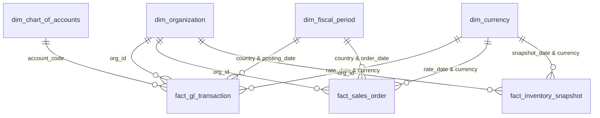

# Cortex Framework V7 Data Products (`src/data_modules/custom/`)

Modul Dataform BigQuery resmi untuk lapisan analitik **Holding Consolidation & SAP DDIC Coexistence**, dibangun berdasarkan **ADR-013 (Cortex Data Products)**, **ADR-014 (Tri-Currency Engine)**, dan **ADR-015 (Composite Partitioning & High-Throughput)**.

Seluruh aset menggunakan namespace kustom `custom` untuk mengisolasi pengembangan organisasi dari pembaruan pustaka Cortex upstream (*upgrade-safe extensibility*).

---

## 1. Cakupan Coexistence Sumber Data

Modul ini dirancang untuk kondisi **Dual SAP Coexistence + ERP Baru**:
- **SAP ECC 6.0**: `BKPF` (header jurnal) + `BSEG` (line item) + `TCURX` (penyesuaian skala desimal mata uang non-2 desimal) dengan konversi tanda Debit/Kredit (`SHKZG`: `'S'` = `+`, `'H'` = `-`).
- **SAP S/4HANA**: `ACDOCA` (Universal Journal, Leading Ledger `RLDNR = '0L'`) yang sudah menyimpan 3 lapisan mata uang (*Transaction `TSL`*, *House/Functional `HSL`*, *Group `KSL`*) + join `BKPF`. Menggunakan `DOCLN` untuk menjamin keunikan line item dan mencegah tabrakan primary key pada `BUZEI = '000'`.
- **ERP Baru (Go Microservices)**: Aliran event CDC Kafka (`stg_gl_journal_cdc`, `stg_sales_order_cdc`, `stg_inventory_snapshot`, `stg_organizations_cdc`, `stg_exchange_rates_cdc`, `stg_chart_of_accounts_cdc`, `stg_items_cdc`, `stg_holding_coa_mapping`) dari layanan core ERP.

Kolom sistem internal S/4HANA **`_dataaging` secara eksplisit dikecualikan** di seluruh definisi view dan tabel sesuai standar pemodelan Cortex.
Field tanggal SAP DATS ('00000000' / kosong) disanitasi menggunakan helper `safeSapDate` untuk mencegah kegagalan runtime CAST pada BigQuery.

---

## 2. Arsitektur 4-Lapisan Data Product

```text
  [ SAP DDIC Replica ]                  [ Go Microservices CDC ]
  BKPF, BSEG, ACDOCA, MARD,             stg_gl_journal_cdc,
  VBAK, VBAP, MARC, T001, TVKO          stg_sales_order_cdc, orgs...
          │                                      │
          ▼                                      │
  Layer 1: definitions/foundations/              │
  (stg_bkpf, stg_bseg, stg_acdoca,               │
   stg_marc, stg_mard, stg_tvko...)              │
          │                                      │
          └──────────────────┬───────────────────┘
                             ▼
  Layer 2: definitions/annotations/ (Semantic Normalization)
  (ann_gl_document, ann_sales_order, ann_material, ann_purchase_order)
   - Normalisasi nama kolom snake_case
   - Penyesuaian desimal TCURX & tanggal dummy SAP ('00000000' -> NULL)
   - Pemetaan TVKO (VKORG -> BUKRS) untuk eliminasi join fan-out
   - Penyatuan ECC + S/4HANA + NEW_ERP
                             │
                             ▼
  Layer 3: definitions/products/ (Dimensional Star Schema)
  Dimensions: dim_organization, dim_organization_closure, dim_currency, dim_fiscal_period, dim_chart_of_accounts
  Facts:      fact_gl_transaction, fact_sales_order, fact_inventory_snapshot
   - Kurs Tri-Currency (TC -> FC -> PC/USD) dengan kuotasi tidak langsung & triangulasi USD
   - Partisi bulanan (GL, Sales, Currency) & harian (Inventory)
                             │
                             ▼
  Data Quality Tests: definitions/tests/
  (assert_gl_balance, assert_org_referential_integrity, assert_tri_currency_completeness, assert_fx_rate_coverage)
```

---

## 3. Diagram Star Schema



---

## 4. Katalog Direktori & Model

```text
src/data_modules/custom/
├── workflow_settings.yaml               # Konfigurasi proyek Dataform v3 (target_dataset: erp_analytics)
├── package.json                         # Dependensi @dataform/core dan devDependencies @dataform/cli
├── manifest.yaml                        # Deklarasi dependensi SAP (ECC + S/4HANA)
├── table_settings.default.yaml          # Strategi partisi & clustering tabel (ADR-015)
├── includes/
│   ├── currency.js                      # Helper scaling desimal TCURX
│   └── sap_helpers.js                   # Helper sanitasi tanggal safeSapDate & watermark
├── definitions/
│   ├── declarations/                    # Sumber data eksternal BigQuery
│   │   ├── sap_ddic_sources.js          # Deklarasi 23 tabel sap_ddic_replica
│   │   └── erp_staging_sources.js       # Deklarasi 8 tabel erp_staging CDC
│   ├── foundations/                     # Layer 1 — Replikasi Raw SAP DDIC (20 staging views)
│   │   ├── stg_acdoca.sqlx              # SAP Universal Journal (S/4HANA Leading Ledger 0L)
│   │   ├── stg_bkpf.sqlx                # SAP Accounting Document Header
│   │   ├── stg_bseg.sqlx                # SAP Accounting Document Line Item (ECC)
│   │   ├── stg_dd03l.sqlx               # Katalog field DDIC (active filter AS4LOCAL = 'A')
│   │   ├── stg_ekko.sqlx                # SAP Purchasing Order Header
│   │   ├── stg_ekpo.sqlx                # SAP Purchasing Order Item
│   │   ├── stg_makt.sqlx                # SAP Material Descriptions (fallback EN > ID > others)
│   │   ├── stg_mara.sqlx                # SAP General Material Data
│   │   ├── stg_marc.sqlx                # SAP Plant Data for Material (LGORT excluded)
│   │   ├── stg_mard.sqlx                # SAP Storage Location Data for Material
│   │   ├── stg_matdoc.sqlx              # SAP Material Documents
│   │   ├── stg_mbew.sqlx                # SAP Material Valuation
│   │   ├── stg_ska1.sqlx                # SAP CoA Master (SKA1 + SKAT)
│   │   ├── stg_t001.sqlx                # SAP Company Codes
│   │   ├── stg_t009b.sqlx               # SAP Fiscal Year Variant Periods
│   │   ├── stg_tcurr.sqlx               # SAP Exchange Rates
│   │   ├── stg_tcurx.sqlx               # SAP Currency Decimal Shift
│   │   ├── stg_tvko.sqlx                # SAP Sales Org to Company Code mapping (VKORG -> BUKRS)
│   │   ├── stg_vbak.sqlx                # SAP Sales Order Header
│   │   └── stg_vbap.sqlx                # SAP Sales Order Item
│   ├── annotations/                     # Layer 2 — Normalisasi Semantik Lintas Sistem (4 views)
│   │   ├── ann_gl_document.sqlx         # Unifikasi GL (ECC + S/4HANA + ERP CDC)
│   │   ├── ann_material.sqlx            # Unifikasi Material Master (MARA + MAKT + MARC + MARD)
│   │   ├── ann_purchase_order.sqlx      # Unifikasi PO (EKKO + EKPO + TCURX)
│   │   └── ann_sales_order.sqlx         # Unifikasi Sales Order (SAP SD + TVKO + ERP CDC)
│   ├── products/                        # Layer 3 — Conformed Dimensions & Fact Tables (8 tables)
│   │   ├── dim_chart_of_accounts.sqlx   # CoA konformasi (LTRIM zero-strip + mapping holding)
│   │   ├── dim_currency.sqlx            # Kurs tri-currency (kuotasi tidak langsung + triangulasi USD)
│   │   ├── dim_fiscal_period.sqlx       # Dual-period fiskal (ekspansi BDATJ = '0000' ke 2020..2030)
│   │   ├── dim_organization.sqlx        # Dimensi organisasi Holding -> Cabang + SAP Company Codes/Plants
│   │   ├── dim_organization_closure.sqlx# Tabel closure hirarki organisasi multi-level
│   │   ├── fact_gl_transaction.sqlx     # Fakta GL (incremental, partisi bulanan posting_date)
│   │   ├── fact_inventory_snapshot.sqlx # Fakta Snapshot Stok (incremental, partisi harian snapshot_date)
│   │   └── fact_sales_order.sqlx        # Fakta Sales Order (incremental, partisi bulanan order_date)
│   └── tests/                           # Layer 4 — Dataform Quality Assertions (4 assertions)
│       ├── assert_fx_rate_coverage.sqlx # Validasi kelengkapan kurs konversi mata uang
│       ├── assert_gl_balance.sqlx       # Validasi Debit = Kredit (FC, PC)
│       ├── assert_org_referential_integrity.sqlx # Integritas referensial FK ke dim_organization
│       └── assert_tri_currency_completeness.sqlx # Kelengkapan nilai triplet moneter (ADR-014)
```

---

## 5. Cara Kompilasi & Verifikasi Lokal Dataform

Untuk memvalidasi sintaksis dan resolusi DAG lokal tanpa menghubungkan ke cluster BigQuery langsung:

```bash
cd src/data_modules/custom

# Validasi dan kompilasi seluruh grafik dependensi SQLX & JS
npx @dataform/cli compile --json
```

**Kriteria Keberhasilan Kompilasi:**
- Exit code: `0`
- `graphErrors.compilationErrors`: kosong (`[]`)
- Output memuat 32 tables/views, 4 assertions, dan 31 source declarations.
- Partisi & klastering terdefinisi pada tabel fakta dan dimensi moneter.

> Catatan: Sesuai tata kelola, perintah `dataform run` atau *deployment* langsung ke BigQuery tidak dieksekusi di lingkungan lokal tanpa otorisasi staging pipeline.

---

## 6. Referensi Arsitektur

- [ADR-013: Cortex Data Products & SAP DDIC Coexistence](../../../docs/adr/ADR-013-cortex-data-products-sap-coexistence.md)
- [ADR-014: Tri-Currency & Multi-Country Accounting Engine](../../../docs/adr/ADR-014-tri-currency-multi-country-engine.md)
- [ADR-015: High-Throughput Partitioning & Scaling](../../../docs/adr/ADR-015-high-throughput-partitioning-sharding.md)
